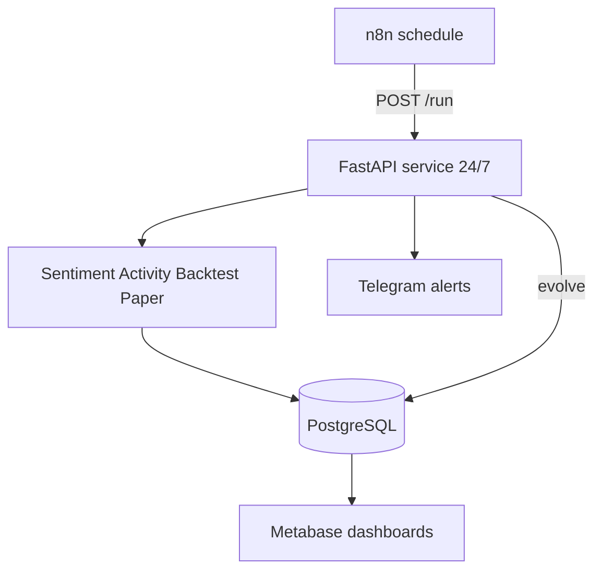

# Deploy on Railway (24/7)

## Cloud-only rule

**Everything that must run 24/7 lives on Railway** (app, Postgres, optional n8n / Metabase / Redis / Telegram).  
The office laptop is only for: edit code → push to GitHub → click Railway UI / set env vars.  
Do **not** leave `python run.py --serve`, Docker Compose, or local cron running on the laptop for production.

## Recommended stack (from your templates)

| Service | Template | Why |
|---------|----------|-----|
| **Trading brain** | **FastAPI / Python / Docker** (this repo) | Runs agents + paper trading + evolution loop |
| **Database** | **PostgreSQL** | Durable strategies, trades, mistakes across restarts |
| **Cache / locks** | **Redis** (optional) | Rate-limit market calls later |
| **Scheduler / glue** | **n8n** | Extra cron + webhook orchestration |
| **Alerts** | **Telegram Bot Python** (or BotFather token) | Push each cycle / champion events |
| **Dashboards** | **Metabase** | Equity curves + strategy leaderboard |

Skip for v1: LibreChat, Flowise, AnythingLLM, Hermes, Chatwoot, Kali, Laravel, Strapi — useful later, not required for paper-trade evolution.



## 1. Create Railway project

1. New Project → **Deploy from GitHub** (push this repo) **or** Docker.
2. Add plugin: **PostgreSQL** (copies `DATABASE_URL` into the service).
3. Optional: add **Redis**, set `REDIS_URL`.
4. Deploy this Dockerfile service (uses `railway.toml`).

## 2. Environment variables

Copy from `.env.example`. Minimum:

- `DATABASE_URL` — auto from Postgres plugin
- `RUN_INTERVAL_MINUTES=30`
- `MARKET_HOURS_ONLY=true`
- `PROFIT_TARGET_PCT=5`
- `MAX_DRAWDOWN_PCT=10`
- `CHAMPION_MIN_TRADES=5`
- `TELEGRAM_BOT_TOKEN` / `TELEGRAM_CHAT_ID`
- `API_KEY` — protect `POST /run`

## 3. Public URL

Generate a Railway domain. Health check: `GET /health`.

Manual force run:

```bash
curl -X POST "https://YOUR-APP.up.railway.app/run?force=true" -H "x-api-key: YOUR_KEY"
```

Status:

```bash
curl "https://YOUR-APP.up.railway.app/status"
```

## 4. n8n (optional but useful)

1. Deploy **n8n** template in same Railway project.
2. Import `deploy/n8n-workflow.json`.
3. Set n8n env: `US_STOCK_API_URL`, `US_STOCK_API_KEY`.
4. Activate workflow (backup trigger if you want dual scheduling).

The FastAPI service already self-schedules with APScheduler — n8n is optional redundancy / custom hours.

## 5. Telegram

1. Create bot with @BotFather → token.
2. Message the bot, get `chat_id` (or use getUpdates).
3. Set `TELEGRAM_BOT_TOKEN` + `TELEGRAM_CHAT_ID` on the FastAPI service.

## 6. Metabase

1. Deploy **Metabase** template.
2. Connect to the same Postgres.
3. Use SQL from `deploy/metabase-queries.md`.

## 7. How “keep going until profitable” works

Every cycle:

1. Sentiment + activity → backtest → paper trades
2. Equity vs `INITIAL_CASH` scored
3. If drawdown > `MAX_DRAWDOWN_PCT` or consistent losses → **retire** strategy, **mutate** MA params, reset paper book
4. If return ≥ `PROFIT_TARGET_PCT` and enough trades → mark **champion**
5. Continue 24/7 (market hours by default)

This is **paper trading only** — not live broker orders.

## 8. Cost tip

Start with: FastAPI + Postgres + Telegram. Add Metabase/n8n after the first week of data.
