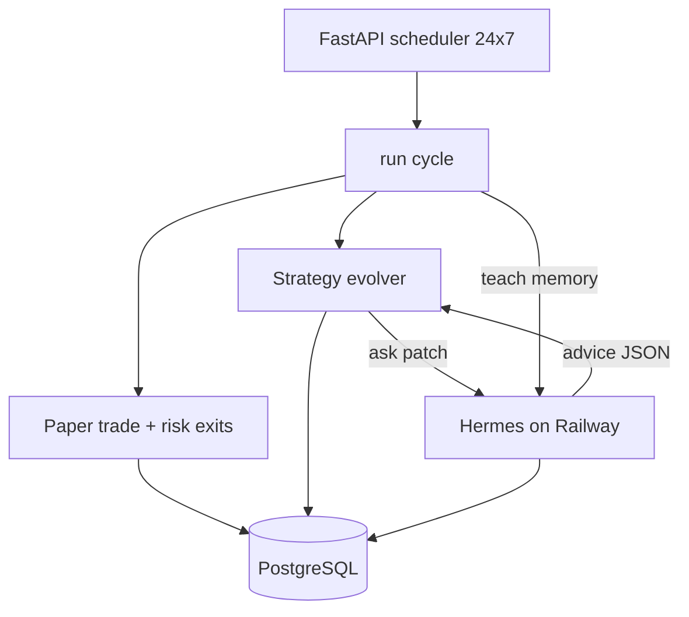

# Hermes 24×7 learning loop (Railway + Postgres)

Hermes coaches strategy mutations. **FastAPI** still runs paper trades and writes everything to **PostgreSQL**. Both must run on Railway (not the laptop).

## Architecture



Loop rule: **keep mutating until a champion hits `PROFIT_TARGET_PCT`** (default +5%) with enough trades. Hermes suggestions are stored in table `hermes_advice`.

## 1. Deploy Hermes (same Railway project)

1. **+ New → Template → Hermes / Hermes Self Improving agent**
2. Attach a **volume** (`/opt/data` or `/data`)
3. Open Hermes domain → `/setup`
4. Add LLM API key (OpenRouter / OpenAI / Anthropic)
5. Enable HTTP API → copy **`API_SERVER_KEY`**
6. Note public URL: `https://….up.railway.app`

## 2. Wire FastAPI (`us-stock-agents` Variables)

| Variable | Value |
|----------|--------|
| `HERMES_ENABLED` | `true` |
| `HERMES_API_URL` | `https://YOUR-HERMES.up.railway.app` |
| `HERMES_API_KEY` | Hermes API key |
| `HERMES_MODEL` | `default` (or model id) |
| `CONTINUE_UNTIL_PROFIT` | `true` |
| `PROFIT_TARGET_PCT` | `5.0` |
| `MAX_DRAWDOWN_PCT` | `10.0` |
| `CHAMPION_MIN_TRADES` | `5` |
| `RUN_INTERVAL_MINUTES` | `30` |
| `MARKET_HOURS_ONLY` | `true` (paper cycles in US session; scheduler stays up 24×7) |

Do **not** change `DATABASE_URL` / Postgres credentials.

## 3. Merge code to `main` so Railway redeploys

```bash
git checkout main
git pull origin main
git merge feature/stop-loss-take-profit
git push origin main
```

## 4. Verify

- `GET /hermes` → `"enabled": true` and advice list  
- `GET /status` → includes `hermes` + `continue_until_profit`  
- `GET /run?force=true` → may show `evolution: mutate|consult` with `source: hermes`  
- Postgres tables: `strategies`, `trades`, `pipeline_runs`, `mistakes`, **`hermes_advice`**

## Honest note

Hermes + paper trading can **search** for parameters that look profitable in simulation. That does **not** guarantee live profit. Stop when you have a champion you trust, then review manually before any real capital.
