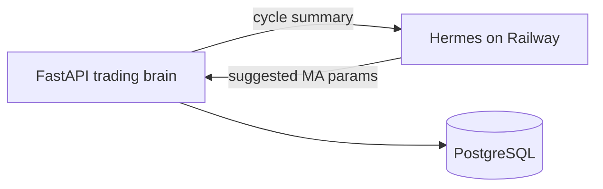

# Hermes Self-Improving Agent on Railway

Hermes (Nous Research) remembers past sessions, improves skills, and coaches our paper-trading mutations. Deploy it **only on Railway** (not the laptop).

## Role in this system

| Without Hermes | With Hermes |
|----------------|-------------|
| Random MA parameter mutations on losses | Hermes proposes next `fast_ma` / `slow_ma` from lessons |
| No long-term narrative memory | Each cycle is taught back to Hermes for later coaching |

Our FastAPI app still owns execution (backtest + paper trades + Postgres). Hermes is the **learning coach**.

## Deploy Hermes (same Railway project)

1. Railway project → **+ New** → **Template** → **Hermes** / **Hermes Self Improving agent**
2. Prefer a template with a **persistent volume** (`/opt/data` or `/data`) so memory survives redeploys
3. Open Hermes dashboard / `/setup` on its public domain
4. Configure an LLM provider key (OpenRouter / Anthropic / OpenAI — whatever the template asks)
5. Enable HTTP API if the template supports it (`API_SERVER_KEY` or similar)
6. Optional: connect Telegram on Hermes for chat coaching

## Wire into our FastAPI service

On the **us-stock-agents** service Variables:

| Variable | Value |
|----------|--------|
| `HERMES_ENABLED` | `true` |
| `HERMES_API_URL` | `https://YOUR-HERMES.up.railway.app` (no trailing slash issues OK) |
| `HERMES_API_KEY` | Hermes `API_SERVER_KEY` / bearer from `/setup` |
| `HERMES_MODEL` | `default` or the model id Hermes exposes |

Redeploy the FastAPI service after saving.

## Verify

1. Force a cycle: `POST /run?force=true`
2. On a losing / drawdown strategy, check `strategies.notes` — should mention `Hermes-mutated...`
3. Response JSON includes `"hermes_taught": true` when memory write succeeds

If Hermes is down, the app **falls back** to random mutation so paper trading never stops.
